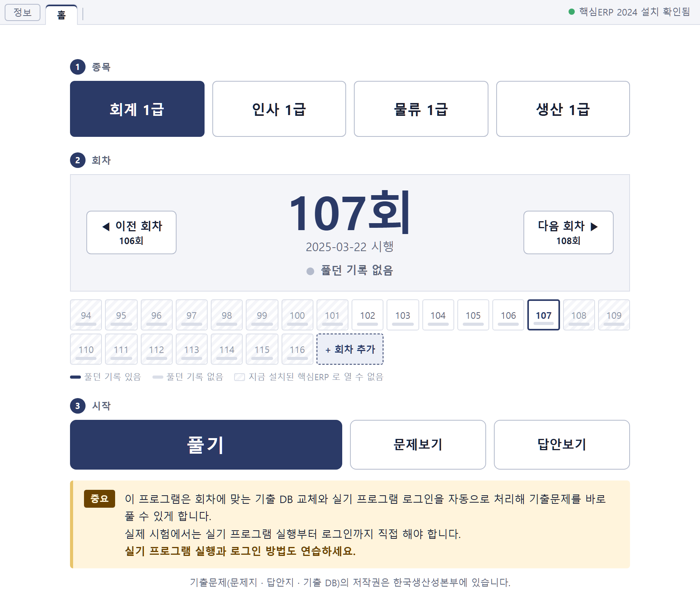

# 기출문제풀기 ERP정보관리사

ERP 정보관리사 1급(회계 · 인사 · 물류 · 생산) 기출문제 회차 DB 를 iCUBE 핵심ERP 에 바로 연결해 풀 수 있게 하는 Windows 프로그램입니다.

## 하는 일

- 종목과 회차를 선택하고 [풀기] 를 클릭하면 그 회차 기출 DB 를 핵심ERP 에 연결하고, 핵심ERP 를 실행해 그 회차 회사로 로그인까지 처리합니다.
- 화면 아래에 로그인한 회사코드와 실무 남은 시간(40분)이 표시됩니다.
- 문제지 옆 답안 입력 열에 이론 · 실무 답을 입력하고 [채점] 을 클릭하면 맞은 수와 틀린 문항이 표시됩니다.
- 주관식은 표기 방식에 따라 채점이 맞지 않을 수 있어, 표시한 정답과 직접 비교해 확인합니다.
- [문제보기] · [답안보기] 로 이론 · 실무 문제지와 답안지를 바로 확인합니다.
- 회차 자료는 회차를 처음 열 때 다운로드하고, 회차 자료가 새로 바뀌면 다시 다운로드합니다.
- 목록에 없는 회차는 공식 가이드의 기출 DB 다운로드 경로에서 받은 기출 DB 압축 파일을 [회차 추가] 에 끌어다 놓아 추가합니다.

## 필요한 것

- Windows 10 (32비트 · 64비트) · Windows 11
- iCUBE 핵심ERP 교육용 프로그램
  - 한국생산성본부 ERP 정보관리사 사이트에서 다운로드해 설치합니다: https://license.kpc.or.kr
  - 회차마다 필요한 핵심ERP 연도가 있습니다 (94\~95회 2022, 96\~101회 2023, 102\~107회 2024, 108\~113회 2025, 114회부터 2026).
    - 설치된 연도와 다른 회차는 [풀기] 를 실행할 수 없고, 이유가 회차 정보에 표시됩니다.
    - 설치된 연도를 확인하지 못하면 [풀기] 아래 안내를 보고 연도를 확인한 뒤 실행합니다.

## 설치

1. [최신 설치 파일 다운로드](https://github.com/program-going/gichulpulgi-erp/releases/latest) 에서 `.exe` 파일을 다운로드합니다.
2. 다운로드한 파일을 실행하고 설치 화면의 안내대로 진행합니다.
   - 처음 실행할 때 'Windows의 PC 보호' 창이 나오면 [추가 정보] → [실행] 을 클릭합니다.
3. 바탕화면의 [기출문제풀기 ERP정보관리사] 를 실행합니다.

지난 버전은 [Releases](https://github.com/program-going/gichulpulgi-erp/releases) 에 있습니다.

최신 버전을 받을 수 있도록 GitHub 주소만 공유해 주세요.

## 핵심ERP DB 교체

[풀기] 를 클릭하면 핵심ERP DB 가 그 회차 DB 로 교체됩니다.

처음 교체할 때의 핵심ERP DB 는 백업 폴더로 이동하고, 프로그램의 [정보] → [원래 DB 되돌리기] 로 원래 DB 를 다시 연결할 수 있습니다.

이 프로그램이 연결하지 않은 다른 DB 는 보관 폴더에 날짜별로 최근 3개까지 보관합니다.

## 업데이트

새 버전이 있으면 프로그램을 실행할 때 안내 창이 표시됩니다.

[업데이트] 를 클릭하면 새 버전을 설치하고 프로그램이 다시 실행됩니다.

안내 창을 닫은 뒤에는 [정보] → [업데이트 확인] 으로 새 버전을 직접 확인할 수 있습니다.

## 실제 시험과 다른 점

이 프로그램은 회차에 맞는 기출 DB 교체와 실기 프로그램 로그인을 자동으로 처리해 기출문제를 바로 풀 수 있게 합니다.

실제 시험에서는 실기 프로그램 실행부터 로그인까지 직접 해야 합니다.

실기 프로그램 실행과 로그인 방법도 연습하세요.

## 문의

사용 중 궁금한 점이나 오류는 [Issues](https://github.com/program-going/gichulpulgi-erp/issues) 에 글로 남겨 주세요.

글을 남기려면 GitHub 로그인이 필요합니다.

## 저작권

- 기출문제(문제지 · 답안지 · 기출 DB)의 저작권은 한국생산성본부에 있습니다.
- 프로그램: © 2026 program-going. All rights reserved.
